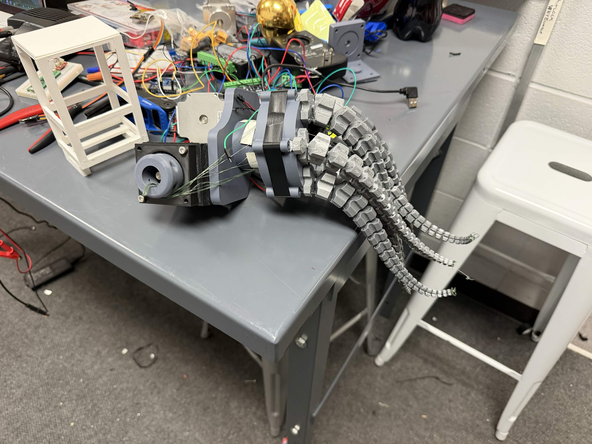
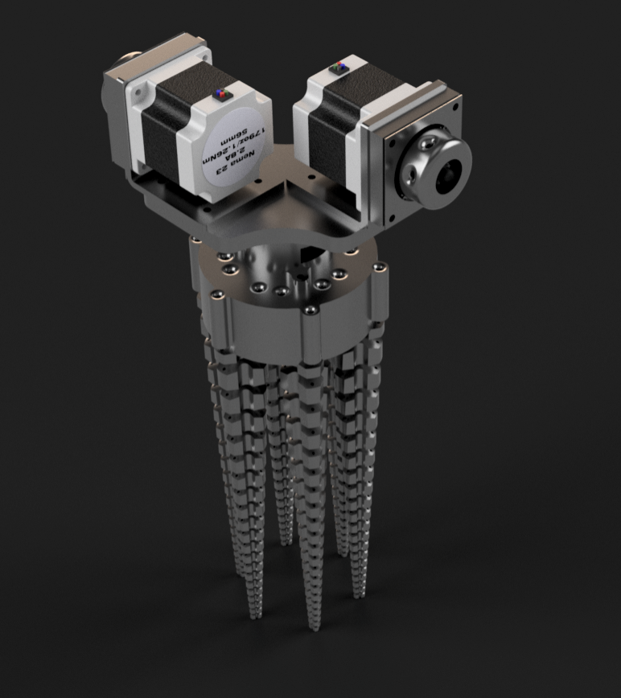
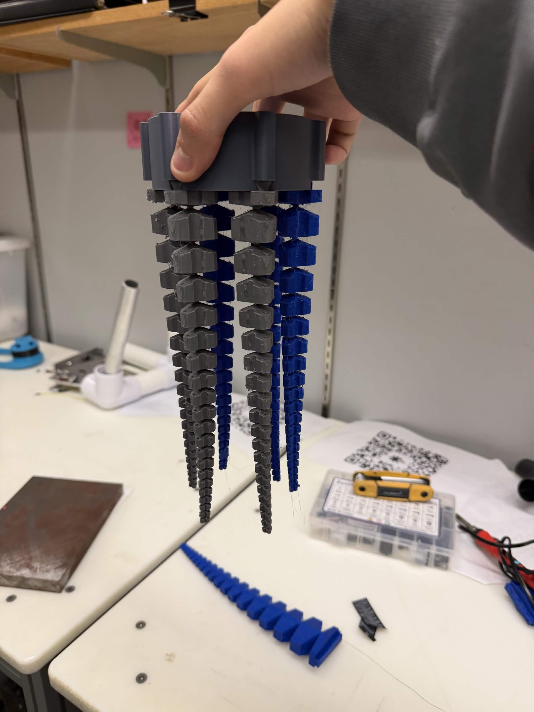

# Leviathan Space Debris Collector

Leviathan is a soft robotic gripper for irregular objects, inspired by the problem of capturing space debris. We built it at UB Hacking 2026 to explore how flexible fingers could wrap around objects with different shapes.

[Watch the demo](https://www.youtube.com/watch?v=DN210jYjKYw) · [Devpost project](https://devpost.com/software/the-leviathan) · [STEP assembly](Link%20To%20Step%20File)



## How it works

- **Gripper.** Six 3D-printed TPU fingers use logarithmic spiral geometry adapted from SpiRobs. Fishing line acts as the tendon. Two NEMA 23 stepper motors wind the inner and outer tendon groups onto spools.
- **Vision.** A USB camera feeds the Python/OpenCV app. The operator can outline a target or ask Gemini to propose one from a snapshot. After confirmation, OpenCV tracks it locally.
- **Control.** The Arduino UNO R4 WiFi reads the ultrasonic sensor and handles step timing. A Grab command pays out the outer tendons while pulling the inner ones. **Prepare / Return Rest** reverses the move.

## Building the prototype

Our work on robotic arms for UB Space Bulls led to a familiar question: how do you grab something when you don't know its shape ahead of time? We modeled the mounts, motor housing, and cable spools in Fusion 360. The first capstan drive let the loaded fishing line cut into the printed drum. We switched to a printed 5:1 planetary gearbox for the hackathon build. [Build notes on Devpost](https://devpost.com/software/the-leviathan#app-details)

<p>
  
  
</p>

The team reported grasping objects of different shapes during the hackathon. In the bench setup, the operator positions and lifts the gripper by hand. Automatic capture requires verified motor travel and measured camera and range settings. Payload testing and integration with a robot arm are next steps. [Validation notes](docs/VALIDATION.md)

## Quick start

Use **Windows and Python 3.13**. Run these commands from the repository root in PowerShell.

```powershell
py -3.13 -m venv .venv
.\.venv\Scripts\python.exe -m pip install -r code\requirements.txt
.\.venv\Scripts\python.exe code\camera_preview.py --camera 0 --port off
```

The first camera is usually index 0. For the team's USB camera, try DirectShow at 800 × 600.

```powershell
.\.venv\Scripts\python.exe code\camera_preview.py --camera 1 --backend dshow --width 800 --height 600 --port off
```

Press **G** to outline and refine an object, then click it in the live preview. **M** shows the mask, **C** clears the selection, and **Q** quits.

For optional Gemini selection, set `GEMINI_API_KEY` or save your key in the ignored file `code/gemini_api_key.txt`. Press **A** and describe the target. The app sends one snapshot and the description to Google. Press **Enter** to confirm the saved-image proposal or **C** to reject it. OpenCV handles tracking after confirmation.

Use the combined grip controller sketch and establish the physical reference before moving the motors. [Setup and controls](docs/SETUP.md) · [Hardware and pin map](docs/HARDWARE.md)

## Test

Run the Python tests from `code/`.

```powershell
Push-Location code
try {
    ..\.venv\Scripts\python.exe -m unittest discover -s tests
} finally {
    Pop-Location
}
```

The tests use synthetic images and simulated devices. See the validation notes for firmware compilation and simulation. [Validation](docs/VALIDATION.md#reproduce-checks)

## Repository guide

| Path | Contents |
| --- | --- |
| [code/](code/) | Host app and Windows launchers |
| [grip_control](code/firmware/grip_control/) | UNO R4 WiFi operating sketch and serial commands |
| [sensor_test](code/firmware/sensor_test/) | Sensor diagnostic sketch |
| [tests](code/tests/) | Python tests and firmware test runners |

## Team and credits

[Andrew Chen](https://devpost.com/andrewchen071407), [Ian Cavalluzzi](https://devpost.com/iancavalluzzi), [Davin Lee](https://devpost.com/davinleeeng), and [Max Lasek](https://devpost.com/maxlasekeng) built Leviathan at UB Hacking 2026.

The fingers draw on **SpiRobs** by Zhanchi Wang, Nikolaos M. Freris, and Xi Wei. The photos, CAD render, and demo video come from the team's Devpost submission. [SpiRobs paper](https://arxiv.org/abs/2303.09861) · [Software and AI credits](docs/CREDITS.md)
